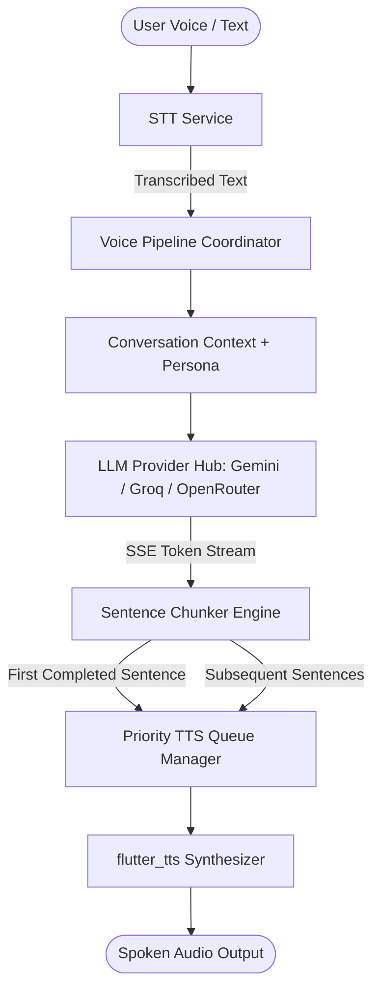

# 🎙️ PolyVoice AI (BYOK Voice Companion)

> **PolyVoice AI** is a lightweight, zero-server-cost cross-platform mobile assistant built with Flutter (Material 3). It utilizes a 100% Client-Side **BYOK (Bring Your Own Key)** architecture where users supply their own free or private API keys (Google Gemini, Groq Cloud, OpenRouter/OpenAI-compatible).

---

## 🌟 Key Features & Core USP

1. **Zero Backend Operational Cost (100% Client-Side)**:
   - Direct device-to-provider streaming via Server-Sent Events (SSE).
   - Encrypted key storage at rest via `flutter_secure_storage` backed by Android Keystore and iOS Keychain.
2. **Ultra Low-Latency Voice Pipeline**:
   - **Sentence-Boundary Chunking (`SentenceChunker`)**: Evaluates punctuation boundaries (`.`, `!`, `?`, `\n`, `。`, `！`, `？`) and feeds the first complete sentence immediately to the TTS engine while remaining tokens continue to stream from Gemini or Groq.
   - **Barge-in / Interruption Support**: Tapping the mic or speaking instantly halts current audio output and clears the playback queue.
3. **Dual Speech-to-Text (STT) Engines**:
   - **Mode A (On-Device)**: Zero token cost, offline transcription via system recognizers (`speech_to_text`).
   - **Mode B (Groq Whisper)**: Cloud-grade, multilingual transcription (`whisper-large-v3`) via user's free Groq key.
4. **Expressive Acoustic Voice Shaper & Persona Engine**:
   - Built-in presets: *Cute & Sweet Companion* (dễ thương, ngọt ngào), *Anime Kouhai*, *Professional Assistant*, *Polyglot Tutor*.
   - Dynamic voice pitch (0.5x – 2.0x, high pitch for cute/young vocal timbre), speed/rate (0.5x – 1.5x), and system voice synthesizer filtering.
5. **Dual Interaction Modes**:
   - **Text & Listen**: Markdown chat with token streaming and tap-to-speak message actions.
   - **Continuous Voice Mode (Live)**: Immersive hands-free screen with an interactive pulsing orb visualizer reacting to voice and AI speech states.

---

## 🏗️ Architecture & Orchestration Flow



---

## 📂 Project Directory Structure

```
lib/
├── main.dart                                # App entry point & dependency injection
├── core/
│   ├── constants/
│   │   ├── api_endpoints.dart               # REST & SSE streaming endpoints
│   │   └── app_constants.dart               # Default models, storage keys, modes
│   ├── errors/
│   │   └── failures.dart                    # Typed failure hierarchy (RateLimit, ApiKey, etc.)
│   ├── theme/
│   │   ├── app_colors.dart                  # Dark/Light & glowing orb gradient palette
│   │   └── app_theme.dart                   # Material 3 dark & light theme specs
│   └── utils/
│       └── sentence_chunker.dart            # Boundary chunker for low-latency TTS
├── services/
│   ├── storage/
│   │   ├── secure_storage_service.dart      # Encrypted BYOK key management
│   │   └── chat_local_storage_service.dart  # Offline chat history persistence
│   ├── llm/
│   │   ├── llm_provider.dart                # Abstract streaming interface
│   │   ├── gemini_service.dart              # Google Gemini SSE stream & ping
│   │   ├── groq_service.dart                # Groq Cloud OpenAI-compatible stream
│   │   ├── openrouter_service.dart          # OpenRouter / Custom OpenAI stream
│   │   └── llm_service_factory.dart         # Provider resolver
│   ├── voice/
│   │   ├── stt_service.dart                 # On-device & Groq Whisper transcription
│   │   ├── tts_service.dart                 # flutter_tts driver & voice enumeration
│   │   └── tts_queue_manager.dart           # Low-latency streaming sentence queue
│   └── pipeline/
│       └── voice_pipeline_coordinator.dart  # The Orchestrator
└── features/
    ├── settings/                            # BYOK keys, Personas & Voice Shaper
    ├── chat/                                # Streaming chat UI & Markdown rendering
    └── voice/                               # Continuous live voice orb experience
```

---

## 🚀 Getting Started

### 1. Prerequisites
- Flutter SDK 3.19+ / 3.x
- Dart 3.x with Null Safety
- Android SDK 34+ / Xcode 15+

### 2. Install Dependencies
```bash
flutter pub get
```

### 3. Run on Device / Emulator
```bash
flutter run
```

---

## 🔑 Setting up BYOK Keys

1. Open **PolyVoice AI**.
2. Tap the `⋮` menu > **Settings & Keys**.
3. Under the **BYOK Keys** tab:
   - **Google Gemini**: Get a free API key at [Google AI Studio](https://aistudio.google.com/).
   - **Groq Cloud**: Get a free API key at [Groq Console](https://console.groq.com/).
   - **OpenRouter**: Get an API key at [OpenRouter](https://openrouter.ai/).
4. Tap **Test Connection** to verify your key against upstream servers before saving.
5. Tap **Save & Apply**.

---

## 📱 Platform Permissions

### Android (`android/app/src/main/AndroidManifest.xml`)
- `RECORD_AUDIO`
- `INTERNET`
- `BLUETOOTH` & `BLUETOOTH_CONNECT`
- Speech Recognition queries `<queries><intent><action android:name="android.speech.RecognitionService"/></intent></queries>`

### iOS (`ios/Runner/Info.plist`)
- `NSMicrophoneUsageDescription`: Permission to access microphone for voice interaction.
- `NSSpeechRecognitionUsageDescription`: Permission for on-device speech transcription.
